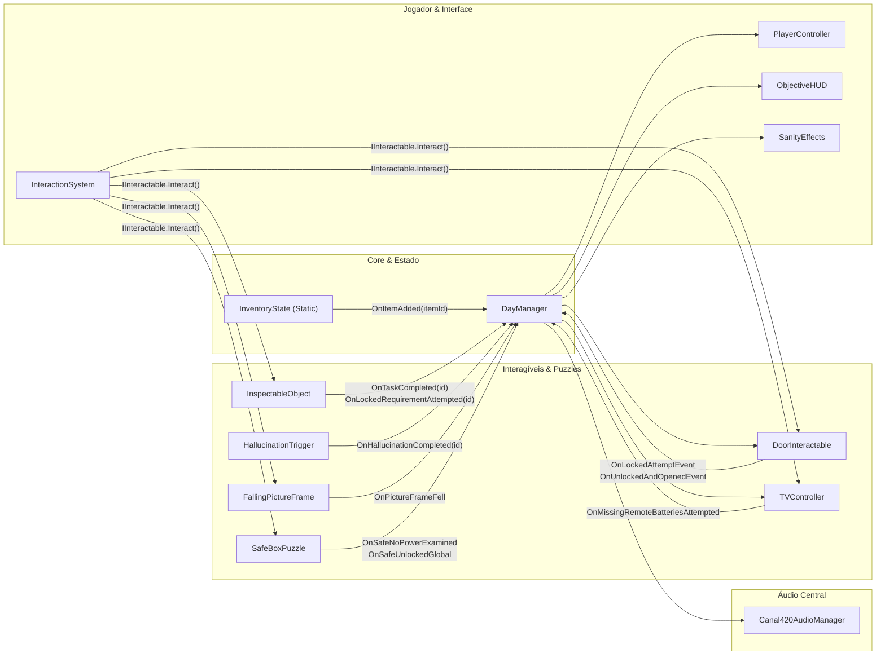

# CANAL 420 — Mapa Completo de Arquitetura, História, Mecânicas e Dependências

> **DOCUMENTO DE REFERÊNCIA OBRIGATÓRIA PARA AGENTES E DESENVOLVEDORES**  
> **Engine:** Unity 6 (`6000.5.0f1`) | **Render Pipeline:** Universal Render Pipeline (URP) | **Input:** Unity New Input System (`1.19.0`)  
> **Cena Principal:** `Assets/Scenes/SampleScene.unity` (Arquitetura de Cena Única — `Greybox_Arquitetura_v38`)

---

## Sumário

1. [Visão Geral e Diretrizes para Futuros Agentes](#1-visão-geral-e-diretrizes-para-futuros-agentes)
2. [História, Lore e Psicologia dos Personagens](#2-história-lore-e-psicologia-dos-personagens)
3. [Fluxo Completo do Jogo e Puzzles (Dia 1 ao Dia 4)](#3-fluxo-completo-do-jogo-e-puzzles-dia-1-ao-dia-4)
4. [Mecânicas de Gameplay e Sistemas Core](#4-mecânicas-de-gameplay-e-sistemas-core)
5. [Modularização e Catálogo de Scripts](#5-modularização-e-catálogo-de-scripts)
6. [Grafo de Dependências, Eventos e Inventário](#6-grafo-de-dependências-eventos-e-inventário)
7. [Arquitetura Espacial da Casa (Coordenadas e Hierarquia)](#7-arquitetura-espacial-da-casa-coordenadas-e-hierarquia)
8. [Sistema de Áudio e Foley (`Canal420AudioManager`)](#8-sistema-de-áudio-e-foley-canal420audiomanager)
9. [Pipeline de Editor, Reconstrução e Build](#9-pipeline-de-editor-reconstrução-e-build)
10. [Regras de Ouro (Checklist Antes de Modificar o Projeto)](#10-regras-de-ouro-checklist-antes-de-modificar-o-projeto)

---

## 1. Visão Geral e Diretrizes para Futuros Agentes

**Canal 420** é um jogo de terror psicológico e exploração em primeira pessoa focado em **dissociação traumática, burnout corporativo e negação do luto**, ambientado na Baixada Santista em meados dos anos 1990.

### Como o projeto é estruturado:
* **Cena Única (`SampleScene.unity`):** Todo o jogo ocorre dentro do mesmo sobrado residencial. A progressão temporal entre os **4 Dias** não carrega cenas diferentes; ela é gerenciada por [`DayManager.cs`](file:///Users/felipemacbook/Documents/Projects/Canal%20420/Assets/Scripts/Core/DayManager.cs), que ativa/desativa grupos inteiros de objetos (`Props_Dia1`, `Props_Dia2`, `Props_Dia3`, `Quarto_Filhas`), altera a iluminação da casa, ajusta os efeitos pós-processamento ([`SanityEffects.cs`](file:///Users/felipemacbook/Documents/Projects/Canal%20420/Assets/Scripts/Effects/SanityEffects.cs)) e modifica a física/passos do jogador ([`PlayerController.cs`](file:///Users/felipemacbook/Documents/Projects/Canal%20420/Assets/Scripts/Player/PlayerController.cs)).
* **Geração Procedural Idempotente (`Canal420GreyboxBuilder.cs`):** Toda a geometria da residência, móveis, colisores, gatilhos, portas, documentos e referências do `DayManager` são construídos e amarrados automaticamente pelo script de editor [`Canal420GreyboxBuilder.cs`](file:///Users/felipemacbook/Documents/Projects/Canal%20420/Assets/Scripts/Editor/Canal420GreyboxBuilder.cs).

---

## 2. História, Lore e Psicologia dos Personagens

### A Dupla Camada Temporal
* **A Ilusão Dissociativa (Outubro de 1995):** Na mente de **Cian Nabs** (34 anos, analista contábil pleno), é domingo à noite, **29 de outubro de 1995**. Ele acredita estar apenas exausto por virar três semanas fazendo balancetes para seu chefe abusivo, **Tavares**, enquanto vive sozinho numa rotina mecânica regada a café velho e sedativos tarja preta.
* **A Realidade Reprimida (Sábado, 10 de Setembro de 1994):** Mais de um ano antes, na noite de **10 de setembro de 1994** (`10/09`), ocorreu uma tragédia familiar no sobrado da Rua das Acácias envolvendo sua esposa **Margaret** e suas **duas filhas pequenas (6 e 8 anos)**. Após o evento, Cian trancou a porta do quarto das meninas no fim do corredor leste, escondeu a chave dentro de um cofre de parede atrás do retrato de Margaret (com a senha `1009`), guardou o recorte de jornal no arquivo metálico e entrou em negação profunda, fingindo trabalhar todos os dias.

### Personagens e Entidades
| Nome / Elemento | Papel Narrativo | Manifestação no Jogo |
|---|---|---|
| **Cian Nabs** | Protagonista (34 anos, contador) | Monólogos internos secos, cansados e telegráficos; sofre de insônia, apagões de memória e dissociação. |
| **Margaret Nabs** | Esposa de Cian | Presente através de sua letra redonda em listas na geladeira, agenda rasgada, bilhete dobrado no escritório, casaco cinza com chave escondida e o jumpscare final no Dia 3. |
| **As Duas Filhas** | Meninas de 6 e 8 anos | Quarto trancado no fim do corredor leste; manifestam-se como choro abafado atrás da porta e na gravação da fita cassete do Dia 2. |
| **Tavares** | Gerente Operacional | Cobrança corporativa opressora usada por Cian como âncora para não pensar na família (recado na secretária no Dia 1 e memorando na mesa). |
| **Canal 420** | Frequência Fantasma na TV | Canal fora do ar que emite um grave hipnótico contínuo. Funciona como catalisador psicológico que derruba a negação de Cian ao longo dos 3 dias. |

> **Nota sobre o Roteiro:** Todos os diálogos e textos seguem rigorosamente o arquivo [`roteiro_completo_canal_420.md`](file:///Users/felipemacbook/Documents/Projects/Canal%20420/roteiro_completo_canal_420.md).

---

## 3. Fluxo Completo do Jogo e Puzzles (Dia 1 ao Dia 4)

```mermaid
flowchart TD
    Start(["Início do Jogo"]) --> D1["DIA 1: Burnout & Rotina\n(Domingo, 29/10/1995)"]
    
    subgraph Fluxo_Dia_1 ["Dia 1 — Tarefas Domésticas e Sintonização"]
        D1 --> D1_Wake["Acorda no Quarto do Casal\nSpawn_Dia1_Cama"]
        D1_Wake --> D1_Sink["1. Lavar o rosto na pia do banheiro\n(id: lavar_rosto)"]
        D1_Sink --> D1_Phone["2. Ouvir recado do Tavares na secretária\n(id: checar_secretaria)"]
        D1_Phone --> D1_TryOffice["3. Tentar abrir porta do Escritório (Trancada)\nRevela tarefa: procurar chave na cozinha"]
        D1_TryOffice --> D1_Key["4. Pegar chave de fita azul no pratinho da copa\n(item: chave_escritorio)"]
        D1_Key --> D1_OpenOffice["5. Destrancar Escritório\n(id: destrancar_escritorio_dia1)"]
        D1_OpenOffice --> D1_Papers["6. Ler Memorando Contábil na escrivaninha\n(id: olhar_papeis)"]
        D1_Papers --> D1_Cal["7. Conferir Calendário Out/1995 na parede\n(id: checar_calendario)"]
        D1_Cal --> D1_TryTV["8. Tentar ligar a TV (Controle sem pilha)\nRevela tarefa: pegar pilhas na cozinha"]
        D1_TryTV --> D1_Batt["9. Pegar pilhas na gaveta da cozinha\n(item: pilhas_controle)"]
        D1_Batt --> D1_SitTV["10. Sentar no sofá e ligar a TV\nCanais 04 -> 09 -> 17 -> 420 (Trava no 420)"]
    end

    D1_SitTV --> D2["DIA 2: O Efeito Depressor\n(Segunda-feira)"]

    subgraph Fluxo_Dia_2 ["Dia 2 — Sedativos, Fita Cassete e Alucinações"]
        D2 --> D2_Wake["Acorda grogue no sofá da sala\nSpawn_Dia2_Sofa (Movimento Lento)"]
        D2_Wake --> D2_Pills["1. Examinar frascos vazios e Receituário na mesa\n(id: frascos_calmantes_dia2)"]
        D2_Pills --> D2_TrySec["2. Examinar secretária apitando sem fita\nRevela tarefa: procurar fita cassete"]
        D2_TrySec --> D2_Tape["3. Pegar fita cassete na borda da pia do banheiro\n(item: fita_secretaria)"]
        D2_Tape --> D2_PlaySec["4. Inserir fita e ouvir choro/respiração\n(id: secretaria_fita_dia2)"]
        D2_PlaySec --> D2_Halluc["5. Eventos do Corredor:\n- Vulto cruzando (vulto_corredor)\n- Quadros trincados (quadros_familia_alterados)\n- Porta trancada com choro (sussurros_porta_trancada)"]
        D2_Halluc --> D2_AutoTV["6. TV liga sozinha na Sala\nPlantão de Setembro/1994 + Invasão do Canal 420"]
    end

    D2_AutoTV --> D3["DIA 3: Apagão & Revelação\n(Casa às Escuras)"]

    subgraph Fluxo_Dia_3 ["Dia 3 — Energia, Pistas 10/09 e Cofre"]
        D3 --> D3_Wake["Acorda no escuro na Sala\nSpawn_Dia3_Sala"]
        D3_Wake --> D3_Frame["1. Tocar retrato torto de Margaret no corredor leste\nQuadro cai e revela Cofre apagado"]
        D3_Frame --> D3_NoPower["2. Examinar cofre sem energia ou Quadro de Força\nRevela busca por fusível e reparo elétrico"]
        D3_NoPower --> D3_Fuse["3. Pegar fusível de louça na caixa de ferramentas (Banheiro)\n(item: fusivel_reserva)"]
        D3_Fuse --> D3_Breaker["4. Trocar fusível no Quadro de Força (Cozinha)\n(item: energia_corredor_ativa)"]
        D3_Breaker --> D3_Clues["5. Investigação Orgânica da Data (10/09):\n- Agenda rasgada no criado-mudo (Sábado, 10 de Setembro)\n- Folha anterior do calendário (riscos param em Sex 09/Set)\n- Chave no casaco cinza -> Jornal da Baixada no arquivo (Sábado, 10)"]
        D3_Clues --> D3_Safe["6. Digitar senha '1009' no Cofre\nObtém chave da porta do corredor (PlayerHasSafeKey = true)"]
        D3_Safe --> D3_Unlock["7. Destrancar porta no fim do corredor leste\nSequência de Ataque de Margaret"]
    end

    D3_Unlock --> D4["DIA 4: Prelúdio / Epílogo\n(Quarto das Filhas)"]
    D4 --> End(["Fim da Demonstração\n[R] Reiniciar  |  [ESC] Sair"])
```

---

## 4. Mecânicas de Gameplay e Sistemas Core

### 4.1. Movimentação e Estados Físicos (`PlayerController.cs`)
* **Controle em Primeira Pessoa:** Baseado em `CharacterController` + `UnityEngine.InputSystem` (`WASD` / Setas para andar, `Mouse Delta` para olhar).
* **Modos de Velocidade e Peso Psicológico:**
  * **Normal (Dia 1):** `normalMoveSpeed = 1.815f` (-25% em relação aos `2.42f` originais), `mouseSensitivity = 0.12f`, passada física `normalStepStride = 1.14f`.
  * **Depressor / Sedativo (Dia 2):** `depressantMoveSpeed = 1.242f` (-10% sobre `1.38f`), `depressantLookSmoothTime = 0.16f`, câmera mais baixa (`depressantCameraDrop = 0.11f`), passada curta e arrastada (`depressantStepStride = 0.86f`).
  * **Droga Ativadora / Alucinógeno (Dia 3):** `activatingDrugMoveSpeed = 2.42f` (mantém a velocidade original de `2.42f`), com responsividade normal de câmera e passada física `normalStepStride = 1.14f`.
* **Sincronia Física Exata Passos + Head-Bob:** O ciclo senoidal avança pelo deslocamento horizontal real no mundo (`lastFrameHorizontalDist / strideLength`), disparando o passo exatamente no fundo da pisada (`3π/2 + 2kπ`) com pré-corte de silêncio inicial nos `.wav` de madeira, evitando passos fantasmas contra paredes e mantendo sincronia perfeita em qualquer velocidade.
* **Olhar Restrito (`RestrictedLook`):** Usado quando Cian está sentado no sofá assistindo TV (Dia 1) e durante o epílogo no Quarto das Filhas (Dia 4). Trava a locomoção e limita o ângulo horizontal/vertical do pescoço.

### 4.2. Sistema de Interação Assistido e Leitor de Documentos (`InteractionSystem.cs`)
* **Detecção Tolerante em 3 Estágios (Zero Frustração):**
  1. `Physics.Raycast` exato no centro da mira (`interactionDistance = 2.85f`).
  2. `Physics.SphereCast` fino (`radius = 0.16f`).
  3. `Physics.SphereCastAll` largo (`radius = 0.32f`) que pontua candidatos pelo alinhamento angular com a câmera (`Vector3.Dot`), garantindo que objetos pequenos como chaves, fitas e bilhetes sejam fáceis de focar.
* **Mira Contextual e Prompt Elegante:** Ponto central discreto que expande quando há um `IInteractable` válido, exibindo uma pílula translúcida com `[E] Ação`.
* **Legendas com Voz Sintetizada (`ShowSubtitle`):** Exibe pensamentos ou falas na parte inferior da tela com fade suave e bips sutis de fala (`SpeechVoiceType.CianThought`, `TVBroadcast`, `AnsweringMachine`).
* **Leitor Modal de Documentos (`ShowDocument`):**
  * Abre uma folha física estilizada na tela com 4 variações visuais (`DocumentStyle`):
    1. `CorporateMemo` (papel timbrado corporativo frio)
    2. `HandwrittenNote` (papel amarelado para bilhetes e agendas manuscritas)
    3. `MedicalPrescription` (receituário azulado clínico)
    4. `NewspaperClipping` (recorte cinzento de jornal)
  * Pausa o controle de câmera, exibe o documento até o jogador fechar com `[E]`, `[Espaço]`, `[ESC]` ou botão na tela, e em seguida dispara o pensamento reflexivo (`afterReadThought`) de Cian.

### 4.3. HUD de Tarefas Calmo (`ObjectiveHUD.cs`)
* Localizado no canto superior esquerdo, pode ser recolhido/aberto com **`[TAB]`**.
* **Modo Foco Calmo (`showSingleActiveTask = true`):** Nunca sobrecarrega o jogador com uma lista gigante. Exibe apenas **uma tarefa pendente por vez** (a próxima tarefa visível na fila). Quando concluída, faz um *strikethrough* suave com som de escrita no papel e revela o próximo objetivo após `0.75s`.

### 4.4. Cofre Numérico de Parede (`SafeBoxPuzzle.cs`)
* Escondido atrás do quadro de Margaret no corredor leste (`FallingPictureFrame.cs`).
* **Dependência Elétrica:** Só abre o teclado numérico se `InventoryState.HasItem("energia_corredor_ativa")` for verdadeiro (fusível trocado no quadro de força da cozinha).
* **Interface Híbrida:** Aceita clique nos botões na tela ou digitação direta no teclado/numpad (`0-9`, `Backspace`, `Enter`, `ESC`).
* **Reação Orgânica de Erro:** Se o jogador tentar digitar o ano (`1994`, `1995` ou `1992`), Cian murmura: *"Não é o ano... É o dia e o mês."* A senha correta é **`1009`** (10 de setembro).

### 4.5. Pós-Processamento e Sanidade (`SanityEffects.cs`)
* Controla em tempo real um `Volume` global do URP com **Vignette**, **Chromatic Aberration**, **Film Grain**, **Lens Distortion**, **Color Adjustments** e **Panini Projection**.
* Transiciona suavemente entre 4 perfis (`PsychologicalState`) e permite picos agudos de distorção (`TriggerHallucinationSpike`) durante sustos, alucinações ou sintonização do Canal 420.

---

## 5. Modularização e Catálogo de Scripts

Todos os scripts residem em `Assets/Scripts/` e são organizados em 8 namespaces:

| Arquivo | Namespace | Classe / Tipo | Responsabilidade Principal |
|---|---|---|---|
| [`DayManager.cs`](file:///Users/felipemacbook/Documents/Projects/Canal%20420/Assets/Scripts/Core/DayManager.cs) | `Canal420.Core` | `DayManager`, `GameDay` | **Orquestrador Mestre.** Controla transições de dia, cartões de título, spawns, bloqueios de portas, iluminação, progressão de tarefas e o jumpscare/final. |
| [`InventoryState.cs`](file:///Users/felipemacbook/Documents/Projects/Canal%20420/Assets/Scripts/Core/InventoryState.cs) | `Canal420.Core` | `InventoryState` (static) | Conjunto global leve (`HashSet<string>`) de itens e flags de estado coletados pelo jogador. |
| [`PlayerController.cs`](file:///Users/felipemacbook/Documents/Projects/Canal%20420/Assets/Scripts/Player/PlayerController.cs) | `Canal420.Player` | `PlayerController` | Locomoção em 1ª pessoa, gravidade, head-bob, detecção de piso para passos, teleporte seguro e restrição de câmera. |
| [`IInteractable.cs`](file:///Users/felipemacbook/Documents/Projects/Canal%20420/Assets/Scripts/Interaction/IInteractable.cs) | `Canal420.Interaction` | `IInteractable` (interface) | Contrato base de interação (`CanInteract`, `GetInteractionPrompt()`, `Interact(GameObject)`). |
| [`InteractionSystem.cs`](file:///Users/felipemacbook/Documents/Projects/Canal%20420/Assets/Scripts/Interaction/InteractionSystem.cs) | `Canal420.Interaction` | `InteractionSystem`, `DocumentStyle` | Raycast/SphereCast no `Camera.main`, UI de mira/prompt, sistema de legendas e leitor modal de documentos. |
| [`InspectableObject.cs`](file:///Users/felipemacbook/Documents/Projects/Canal%20420/Assets/Scripts/Interaction/InspectableObject.cs) | `Canal420.Interaction` | `InspectableObject` | Componente versátil para **4 modos**: Tarefa Simples (`ConfigureTask`), Coleta de Item (`ConfigurePickup`), Receptor de Item (`ConfigureItemReceiver`) e Documento (`ConfigureDocument`), além de bloqueio físico enquanto dentro de gavetas/armários fechados. |
| [`AnimatedContainerInteractable.cs`](file:///Users/felipemacbook/Documents/Projects/Canal%20420/Assets/Scripts/Interaction/AnimatedContainerInteractable.cs) | `Canal420.Interaction` | `AnimatedContainerInteractable`, `ContainerMotionType` | Gavetas deslizantes e portas de armário/guarda-roupa/caixa de ferramentas com animação de abrir/fechar, liberação de itens internos somente quando abertos e suporte a trancas permanentes (criado-mudo de Margaret) ou por chave. |
| [`DoorInteractable.cs`](file:///Users/felipemacbook/Documents/Projects/Canal%20420/Assets/Scripts/Interaction/DoorInteractable.cs) | `Canal420.Interaction` | `DoorInteractable` | Portas com rotação suave de pivô, colisor dinâmico (desativa durante o giro para não empurrar o player), tranca por item ou chave do cofre. |
| [`TVController.cs`](file:///Users/felipemacbook/Documents/Projects/Canal%20420/Assets/Scripts/Interaction/TVController.cs) | `Canal420.Interaction` | `TVController` | Máquina de estados da TV de tubo (`Day1_WaitingForPlayer`, `Day1_SeatedSurfing`, `Day1_LockedOn420`, `Day2_OffIdle`, `Day2_AutonomousNewsWaiting`, `Day3_SilentGlass`). |
| [`SofaTVProxy.cs`](file:///Users/felipemacbook/Documents/Projects/Canal%20420/Assets/Scripts/Interaction/SofaTVProxy.cs) | `Canal420.Interaction` | `SofaTVProxy` | Permite que clicar no próprio sofá na sala redirecione a interação diretamente para o `TVController`. |
| [`HallucinationTrigger.cs`](file:///Users/felipemacbook/Documents/Projects/Canal%20420/Assets/Scripts/Events/HallucinationTrigger.cs) | `Canal420.Events` | `HallucinationTrigger`, `HallucinationType` | Gatilhos `OnTriggerEnter` do Dia 2: `ShadowPass` (vulto correndo), `SwapObjects` (troca quadros normais por distorcidos) e `WhispersOrAudio`. |
| [`FallingPictureFrame.cs`](file:///Users/felipemacbook/Documents/Projects/Canal%20420/Assets/Scripts/Puzzles/FallingPictureFrame.cs) | `Canal420.Puzzles` | `FallingPictureFrame` | Quadro de Margaret no Dia 3 que despenca ao ser tocado e revela o `SafeBoxPuzzle` atrás dele. |
| [`SafeBoxPuzzle.cs`](file:///Users/felipemacbook/Documents/Projects/Canal%20420/Assets/Scripts/Puzzles/SafeBoxPuzzle.cs) | `Canal420.Puzzles` | `SafeBoxPuzzle` | Cofre embutido na parede com verificação de energia, UI de teclado digital, validação da senha `1009` e entrega da chave final. |
| [`SanityEffects.cs`](file:///Users/felipemacbook/Documents/Projects/Canal%20420/Assets/Scripts/Effects/SanityEffects.cs) | `Canal420.Effects` | `SanityEffects`, `PsychologicalState` | Gerenciador do `Volume` URP de pós-processamento e picos de glitch visual. |
| [`ObjectiveHUD.cs`](file:///Users/felipemacbook/Documents/Projects/Canal%20420/Assets/Scripts/UI/ObjectiveHUD.cs) | `Canal420.UI` | `ObjectiveHUD` | Painel de tarefas no canto superior esquerdo (toggle com `TAB`), animando conclusões e gerenciando a flag `IsBlockingModalOpen`. |
| [`GameSettingsUI.cs`](file:///Users/felipemacbook/Documents/Projects/Canal%20420/Assets/Scripts/UI/GameSettingsUI.cs) | `Canal420.UI` | `GameSettingsUI` | Menu minimalista e austero de opções (`OPÇÕES` no HUD ou `[ESC / O]`): controle em tempo real de Áudio, Brilho no escuro (limitado a 80% para preservar a atmosfera sombria) e predefinições de Gráficos URP (`Baixo..Ultra`). |
| [`Canal420AudioManager.cs`](file:///Users/felipemacbook/Documents/Projects/Canal%20420/Assets/Scripts/Audio/Canal420AudioManager.cs) | `Canal420.Audio` | `Canal420AudioManager`, `FoleySoundId` | Motor central de áudio: gerencia Room Tone, loops 3D da TV, bips da secretária, passos alternados e Foley calibrado. |
| [`Canal420GreyboxBuilder.cs`](file:///Users/felipemacbook/Documents/Projects/Canal%20420/Assets/Scripts/Editor/Canal420GreyboxBuilder.cs) | `Canal420.EditorTools` | `Canal420GreyboxBuilder` | Construtor procedural completo da cena Greybox (`Greybox_Arquitetura_v38`). |
| [`Canal420PropDetailBuilders.cs`](file:///Users/felipemacbook/Documents/Projects/Canal%20420/Assets/Scripts/Editor/Canal420PropDetailBuilders.cs) | `Canal420.EditorTools` | `Canal420GreyboxBuilder` (partial) | Construtores de malhas procedurais chanfradas/torneadas (loft/lathe watertight com vertex AO), micro-detalhes sem colisor e props portáteis detalhados (controle, chave, pilhas, fita cassete, frascos, telefone, secretária, fusível etc.), todos com `Y = 0` local = base exata de apoio na superfície. |
| [`Canal420SceneValidator.cs`](file:///Users/felipemacbook/Documents/Projects/Canal%20420/Assets/Scripts/Editor/Canal420SceneValidator.cs) | `Canal420.EditorTools` | `Canal420SceneValidator` | Validador de integridade da cena e auditoria espacial (verifica referências nulas, colisores, tags, spawns, Z-fighting, watertightness e ancoragem). |
| [`Canal420LightingTests.cs`](file:///Users/felipemacbook/Documents/Projects/Canal%20420/Assets/Scripts/Editor/Canal420LightingTests.cs) | `Canal420.EditorTools` | `Canal420LightingTests` | Suíte automatizada de 18 testes de iluminação, shaders CRT, geometria 3D e invariantes de fluxo/gameplay. |
| [`Canal420BuildHelper.cs`](file:///Users/felipemacbook/Documents/Projects/Canal%20420/Assets/Scripts/Editor/Canal420BuildHelper.cs) | `Canal420.Editor` | `Canal420BuildHelper` | Utilitário de 1 clique no menu do Editor para exportar a build Standalone Windows 64-bit (`.exe`). |

---

## 6. Grafo de Dependências, Eventos e Inventário

### 6.1. Diagrama de Arquitetura e Barramento de Eventos

### 6.2. Chaves Globais do `InventoryState`
O estado de progresso de itens usa strings normalizadas (lowercase, sem espaços nas pontas):

| ID do Item (`InventoryState`) | Onde é Obtido | Onde é Consumido / Verificado | Dia |
|---|---|---|---|
| `"chave_escritorio"` | `Pratinho_Chaves_Copa` (Aparador da Copa) | `Porta_Escritorio_Pivot` (`DoorInteractable`) | Dia 1 |
| `"pilhas_controle"` | `Gaveta_Lanterna_Copa` (Balcão Sul da Cozinha) | `DayManager.CanSitAtTVDay1()` / `TVController` | Dia 1 |
| `"fita_secretaria"` | `Fita_Cassete_D2` (Borda da Pia do Banheiro) | `Secretaria_Eletronica_D2` (`InspectableObject` no Corredor) | Dia 2 |
| `"fusivel_reserva"` | `Caixa_Ferramentas_Banheiro` (Estante do Banheiro) | `Quadro_Forca_Dia3` (Parede Oeste da Cozinha) | Dia 3 |
| `"energia_corredor_ativa"` | Concedido por `DayManager` ao concluir `"restaurar_energia_dia3"` | `SafeBoxPuzzle.HasCircuitPower` (Cofre no Corredor Leste) | Dia 3 |
| `"chave_arquivo_pessoal"` | `Guarda_Roupa_Casacos_D3` (Quarto do Casal) | `Arquivo_Metalico_Interagir` (Escritório — Jornal de 1994) | Dia 3 |
| `DoorInteractable.PlayerHasSafeKey` | Flag estática ativada por `SafeBoxPuzzle` ao digitar `1009` | `Porta_Quarto_Pivot` (Porta trancada no fim do Corredor Leste) | Dia 3 |

---

## 7. Arquitetura Espacial da Casa (Coordenadas e Hierarquia)

A residência possui **16m x 14.8m** (`X: -8.0 a +8.0`, `Z: -7.0 a +7.8`), com pé-direito de `2.80m`.

### Mapa de Coordenadas dos Cômodos
* **Corredor Central (`Z: 0.0 a +2.6`, `X: -8.0 a +8.0`):**
  * Entrada Principal / Porta da Rua e Cabideiro a oeste (`X = -7.8`).
  * Aparador do Telefone e Secretária Eletrônica (`X = -2.0, Z = 2.38`).
  * Fotografias da Família na parede sul (`X = 1.6 a 3.1, Z = 0.11`).
  * Retrato de Margaret + Cofre embutido na parede norte leste (`X = 5.80, Z = 2.47`).
  * Porta Trancada do Quarto das Filhas na extremidade leste (`X = 8.2, Z = 0.8`).
* **Banheiro (`X: -8.0 a -3.2`, `Z: +2.6 a +7.4` — Piso Frio):**
  * Pia e Espelho (`X = -5.60, Z = 6.95`), Armário de Remédios (`X = -4.55, Z = 7.22`), Box do Chuveiro (`X = -7.30, Z = 6.70`), Estante de Utilidades / Caixa de Ferramentas (`X = -3.50, Z = 4.60`).
* **Quarto do Casal (`X: -3.2 a +3.2`, `Z: +2.6 a +7.4` — Madeira):**
  * Cama de Casal (`X = 1.30, Z = 6.25`), Criado-mudo de Cian com Despertador (`X = 0.05, Z = 7.09`), Criado-mudo de Margaret (`X = 2.55, Z = 7.09`), Cômoda (`X = -1.60, Z = 7.05`), Guarda-Roupa (`X = -2.80, Z = 5.40`).
* **Cozinha e Copa (`X: -8.0 a -3.2`, `Z: -7.0 a 0.0` — Piso Frio):**
  * Geladeira (`X = -7.55, Z = -6.35`), Balcão Sul com Pia, Gaveta da Lanterna e Fogão (`Z = -6.60`), Mesa de Jantar (`X = -5.50, Z = -2.60`), Aparador com Pratinho de Chaves (`X = -7.62, Z = -3.40`), Quadro de Força (`X = -7.87, Z = -1.60`).
* **Sala de Estar (`X: -3.2 a +3.2`, `Z: -7.0 a 0.0` — Madeira):**
  * Rack e TV de Tubo (`X = -0.20, Z = -6.42`), Mesa de Centro (`X = -0.20, Z = -4.75`), Sofá de 3 Lugares (`X = -0.20, Z = -3.05`), Estante de Livros (`X = -2.45, Z = -6.70`), Poltrona com Manta (`X = 2.10, Z = -6.10`).
* **Escritório Particular (`X: +3.2 a +7.6`, `Z: -6.2 a 0.0` — Madeira):**
  * Porta trancada no Dia 1 (`X = 4.2, Z = 0.0`), Escrivaninha com Memorando e Gaveta de RH (`X = 6.95, Z = -3.20`), Calendário de Parede (`X = 7.48, Z = -1.70`), Arquivo Metálico (`X = 7.25, Z = -5.30`), Estante de Balancetes (`X = 4.50, Z = -5.95`).
* **Quarto das Filhas (`X: +8.2 a +12.6`, `Z: -1.4 a +3.0` — Oculto até o fim do Dia 3):**
  * Duas camas infantis (azul e rosa), tapete central, mesinha de desenhos e janela lacrada com tábuas.

---

## 8. Sistema de Áudio e Foley (`Canal420AudioManager`)

O gerenciador [`Canal420AudioManager.cs`](file:///Users/felipemacbook/Documents/Projects/Canal%20420/Assets/Scripts/Audio/Canal420AudioManager.cs) opera com arquitetura híbrida:
1. **Clipes Reais Importados (`Assets/Audio/`):**
   * `Assets/Audio/Footsteps/`: 9 passos de madeira (`step_wood_01..09.wav`), 9 passos de piso frio (`step_tile_01..09.wav`) e 4 passos pesados arrastados (`step_heavy_01..04.wav`).
   * `Assets/Audio/Ambience/`: Room tone da casa, chiado normal de TV e drone hipnótico do Canal 420.
   * `Assets/Audio/Foley/`: 28 efeitos táteis (água na pia curta de `2.15s`, chacoalhar de pílulas de `0.85s`, chaves de `1.05s`, 5 variações distintas de portas de armários/gavetas/arquivos para evitar repetição mecânica, disjuntor, fita cassete, vidro quebrando, choro no corredor e jumpscare).
2. **Duplo Canal Alternado de Passos (`footstepSourceA` / `footstepSourceB`):**
   * Evita que o final da reverberação de um passo seja cortado pelo próximo passo e sorteia clipes sem repetição consecutiva.
3. **Mixagem Calibrada (`GetCalibratedFoleyVolume`):**
   * Normaliza individualmente o ganho de cada `FoleySoundId` para que nenhum som estoure ou fique alto demais em relação à ambiência.
4. **Fallback Procedural Seguro:**
   * Caso algum `AudioClip` não esteja atribuído, o `GenerateAllClips()` sintetiza em memória ondas equivalentes no `Awake()`, garantindo **zero `NullReferenceException`** mesmo em ambientes de teste limpos.

---

## 9. Pipeline de Editor, Reconstrução e Build

### Menus Customizados no Unity Editor (Barra Superior `Canal 420`):
1. **`Canal 420 ➔ Construir e Corrigir Residência Greybox Completa`** ([`Canal420GreyboxBuilder.cs`](file:///Users/felipemacbook/Documents/Projects/Canal%20420/Assets/Scripts/Editor/Canal420GreyboxBuilder.cs))
   * Reconstrói toda a geometria, luzes, portas, itens de cada dia e reconecta todas as referências serializadas do `DayManager`, `TVController`, `SafeBoxPuzzle` e `Canal420AudioManager`.
   * Também roda automaticamente no `InitializeOnLoad` se detectar que o marcador `VersionMarkerName` (`Greybox_Arquitetura_v38`) ou os checks de fase mudaram.
2. **`Canal 420 ➔ Validar Cena Completa (Diagnóstico)`** ([`Canal420SceneValidator.cs`](file:///Users/felipemacbook/Documents/Projects/Canal%20420/Assets/Scripts/Editor/Canal420SceneValidator.cs))
   * Inspeciona todos os objetos e imprime um relatório de integridade no Console.
3. **`Canal 420 ➔ Exportar Jogo para Windows (.exe)`** ([`Canal420BuildHelper.cs`](file:///Users/felipemacbook/Documents/Projects/Canal%20420/Assets/Scripts/Editor/Canal420BuildHelper.cs))
   * Gera a build nativa `StandaloneWindows64` diretamente em `Builds/Windows/Canal420.exe` usando o módulo local `WindowsStandaloneSupport`.

---

## 10. Regras de Ouro (Checklist Antes de Modificar o Projeto)

Qualquer agente de IA ou desenvolvedor que for alterar este projeto **DEVE** respeitar as seguintes regras:

1. **NUNCA edite objetos gerados da cena apenas pelo Inspector sem atualizar o `Canal420GreyboxBuilder.cs`:**
   * Como o `Canal420GreyboxBuilder` reconstrói os containers `Greybox_Arquitetura_v7`, `Props_Dia1`, `Props_Dia2` e `Props_Dia3`, qualquer ajuste em textos, posições de objetos, colisores ou sons deve ser feito no código de [`Canal420GreyboxBuilder.cs`](file:///Users/felipemacbook/Documents/Projects/Canal%20420/Assets/Scripts/Editor/Canal420GreyboxBuilder.cs) e acompanhado do incremento de `VersionMarkerName` (ex: para `v8`, limpando o `v7` anterior).
2. **Preserve a Normalização de IDs (`NormalizeKey`):**
   * Todos os IDs de tarefas (`taskId`), alucinações (`hallucinationId`) e itens (`InventoryState`) são comparados em `lowercase` e `Trim()`. Mantenha consistência estrita entre os IDs registrados em `DayManager.PopulateObjectivesForDay()` e os configurados em `Canal420GreyboxBuilder.cs`.
3. **Respeite o Bloqueio de Modais (`ObjectiveHUD.IsBlockingModalOpen`):**
   * Quando o Leitor de Documentos (`InteractionSystem.IsDocumentOpen`) ou o Teclado do Cofre (`SafeBoxPuzzle`) estiverem abertos na tela, `ObjectiveHUD.IsBlockingModalOpen` fica `true` e o `PlayerController` desativa a rotação da câmera e o movimento. Sempre restaure esse estado ao fechar qualquer UI modal.
4. **Mantenha o Tom Narrativo (`roteiro_completo_canal_420.md`):**
   * As frases de Cian devem ser curtas, secas, humanas e carregadas de cansaço/negação. Nunca introduza textos longos, explicativos ou que entreguem explicitamente dicas de puzzles ("isso parece uma senha").
5. **Valide sempre com `dotnet build`:**
   * Antes de concluir qualquer tarefa, execute `dotnet build Assembly-CSharp.csproj && dotnet build Assembly-CSharp-Editor.csproj` e garanta **0 erros e 0 avisos**.
